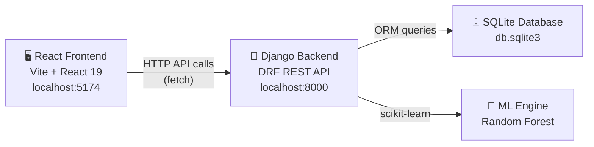
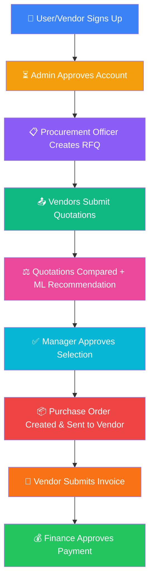
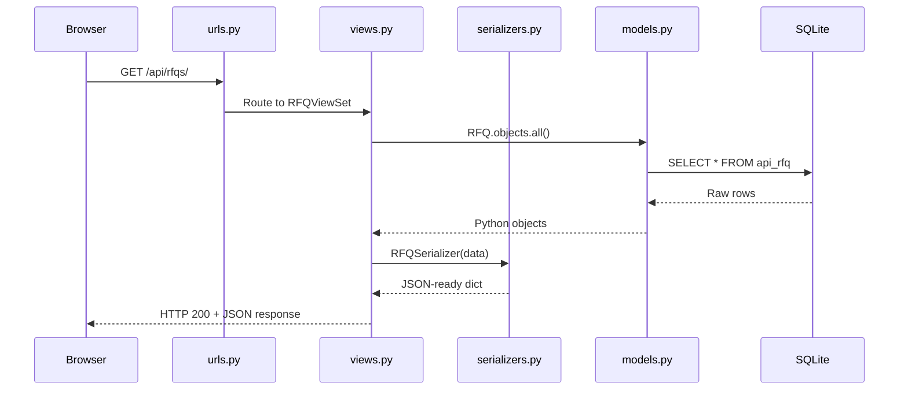
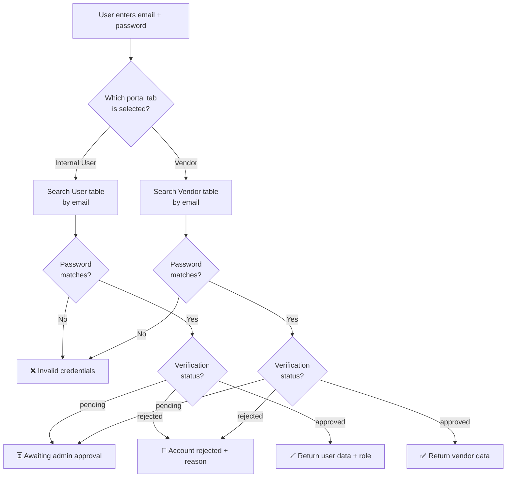
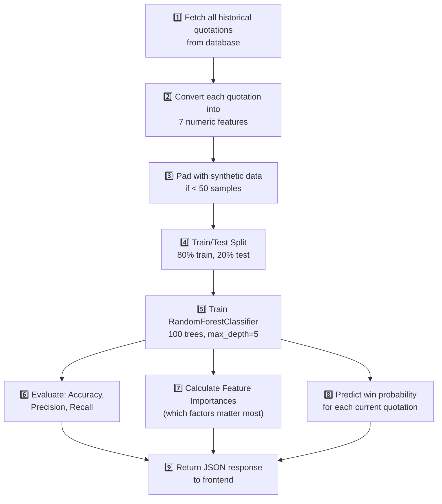
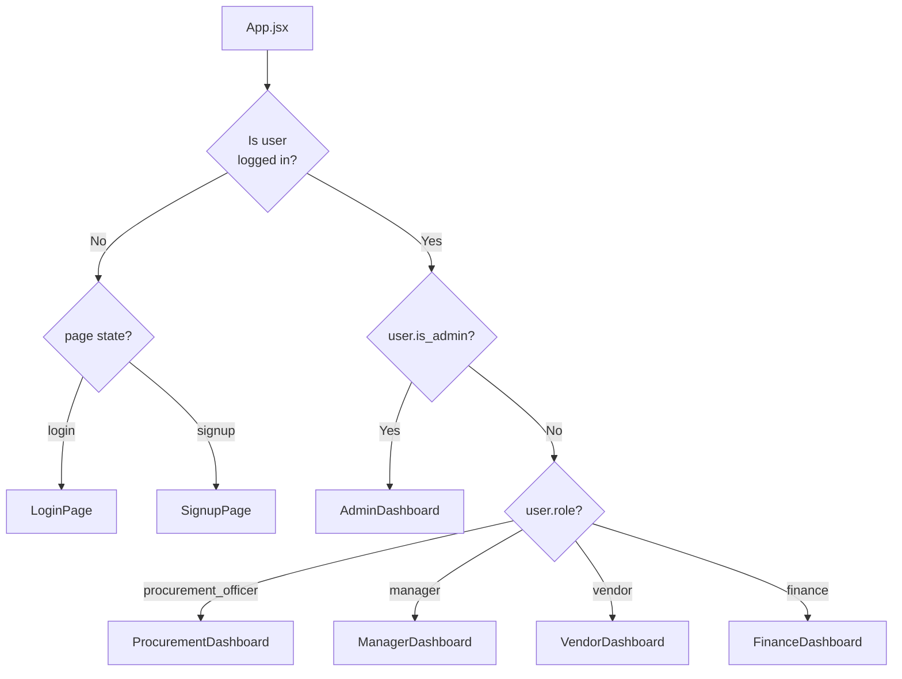

# 🏗️ VendorBridge — Complete Project Walkthrough

> **Your project in one line:** A procurement management system where companies can create purchase requests, vendors submit quotes, managers approve them, and finance handles payment — all with an ML-powered vendor recommendation engine.

---

## 📐 Big Picture Architecture



Your app has **3 layers**:
1. **Frontend (React)** — What users see and click on
2. **Backend (Django REST)** — Business logic + API
3. **Database (SQLite)** — Where all data is stored

---

## 🗄️ Layer 1: The Database (What gets stored)

All your data lives in [models.py](file:///d:/VendorBridge/backend/api/models.py). Think of each model as a **table in a spreadsheet**.

### The Data Flow (in order of how things happen)



### Your Database Tables

| Model | What it stores | Key fields |
|-------|---------------|------------|
| **Department** | Company departments (Engineering, IT, Finance, etc.) | `name`, `code` |
| **User** | Internal employees (officers, managers, finance) | `name`, `email`, `password`, `role`, `verification_status` |
| **Vendor** | External supplier companies | `vendor_code`, `name`, `email`, `category`, `gst_number`, `rating` |
| **RFQ** | "Request for Quotation" — what the company wants to buy | `title`, `quantity`, `deadline`, `priority`, `status` |
| **RFQVendor** | Which vendors are invited to bid on an RFQ | `rfq` → RFQ, `vendor` → Vendor |
| **Quotation** | A vendor's price bid on an RFQ | `unit_price`, `total_price`, `delivery_days`, `status` |
| **VendorSelection** | Records which vendor was selected and why | `selection_reason`, `status` |
| **Approval** | Manager's approve/reject decision | `approval_type`, `status`, `remarks` |
| **PurchaseOrder** | Official order sent to the winning vendor | `po_number`, `total_value`, `delivery_address`, `status` |
| **Invoice** | Vendor's bill for payment | `invoice_number`, `amount`, `bank_name`, `status` |
| **ActivityLog** | Audit trail of who did what | `user`, `action`, `entity_type` |
| **Notification** | System notifications | `user`, `message`, `type` |

### Smart Behaviors (Auto-triggers in `save()` methods)

Your models have built-in logic that runs automatically when data is saved:

1. **Quotation.save()** — When a quotation is marked `selected`:
   - Automatically sets the RFQ status to `completed`
   - Automatically rejects all other competing quotations

2. **PurchaseOrder.save()** — When a PO is created:
   - Sets expected delivery date from RFQ deadline
   - Marks the RFQ as `completed`
   - Rejects competing quotations

3. **Invoice.save()** — When invoice status changes:
   - If `paid` → PO status becomes `paid`
   - If `rejected` → PO status becomes `rejected_by_finance`

---

## 🐍 Layer 2: The Backend API (The brain)

### How Django is set up

```
backend/
├── manage.py                          ← Django CLI entry point
├── db.sqlite3                         ← Your actual database file
├── vendorbridge_backend/
│   ├── settings.py                    ← Config (installed apps, CORS, DB)
│   └── urls.py                        ← Root URL: /api/ → api app
└── api/
    ├── models.py                      ← Database tables (covered above)
    ├── serializers.py                 ← Converts DB objects ↔ JSON
    ├── views.py                       ← All business logic + endpoints
    └── urls.py                        ← API route definitions
```

### How a request flows through Django



### API Endpoints Explained

Your [urls.py](file:///d:/VendorBridge/backend/api/urls.py) defines these routes (all under `/api/`):

#### Auth Endpoints (Custom views)
| Endpoint | Method | What it does |
|----------|--------|-------------|
| `/api/auth/signup/user/` | POST | Register as internal user (pending approval) |
| `/api/auth/signup/vendor/` | POST | Register as vendor company (pending approval) |
| `/api/auth/login/` | POST | Login — checks portal type (user vs vendor) |

#### Admin Endpoints
| Endpoint | Method | What it does |
|----------|--------|-------------|
| `/api/admin/pending/users/` | GET | List users awaiting approval |
| `/api/admin/pending/vendors/` | GET | List vendors awaiting approval |
| `/api/admin/accounts/` | GET | All accounts with stats |
| `/api/admin/verify/user/<id>/` | POST | Approve or reject a user |
| `/api/admin/verify/vendor/<id>/` | POST | Approve or reject a vendor |

#### CRUD Endpoints (Auto-generated by DRF ViewSets)

Each ViewSet automatically creates these 5 endpoints:
| Pattern | Method | Action |
|---------|--------|--------|
| `/api/rfqs/` | GET | List all RFQs |
| `/api/rfqs/` | POST | Create new RFQ |
| `/api/rfqs/<id>/` | GET | Get single RFQ |
| `/api/rfqs/<id>/` | PATCH | Update RFQ fields |
| `/api/rfqs/<id>/` | DELETE | Delete RFQ |

This same pattern applies to: `departments`, `users`, `vendors`, `quotations`, `purchase-orders`, `invoices`, `approvals`

#### Special Endpoints
| Endpoint | What it does |
|----------|-------------|
| `/api/seed/` | Populates sample data (departments, users, vendors) |
| `/api/rf-recommendations/` | Runs the ML model for vendor recommendations |

### Serializers — The JSON Translators

[serializers.py](file:///d:/VendorBridge/backend/api/serializers.py) defines how database objects become JSON. For example:

```python
class RFQSerializer:
    # When you GET an RFQ, you also get nested department and creator info:
    department_details = DepartmentSerializer(source='department')  # Nested!
    created_by_details = UserSerializer(source='created_by')        # Nested!
    
    # Auto-generates numbers like "RFQ-2026-4821" on creation
    def create(self, validated_data):
        validated_data['rfq_number'] = f"RFQ-2026-{random.randint(1000, 9999)}"
```

> [!TIP]
> **Why nested serializers?** When the frontend gets an RFQ, it needs the department name and creator's name too — not just their IDs. Nested serializers include that related data in one API call instead of requiring multiple requests.

### The Login Flow (Most important to understand)

Here's what happens when someone clicks "Sign In" in [views.py login_user](file:///d:/VendorBridge/backend/api/views.py#L145-L207):



> [!IMPORTANT]
> **No real authentication!** Passwords are stored in plain text and compared directly. There are no JWT tokens, no sessions, no hashing. This is fine for a college project, but never for production.

---

## 🤖 Layer 2.5: The ML Engine (Random Forest)

Your [ML endpoint](file:///d:/VendorBridge/backend/api/views.py#L496-L654) is the coolest part. Here's what it does step-by-step:

### How the Random Forest Recommendation Works



### The 7 Features Used

| # | Feature | What it measures | How it's calculated |
|---|---------|-----------------|-------------------|
| 1 | **Price Competitiveness** | Is the price good? | `100 - (unit_price / 2000)` |
| 2 | **Vendor Rating** | Overall vendor quality | `(rating / 5.0) × 100` |
| 3 | **Delivery Time** | How fast they deliver | `100 - (delivery_days × 3)` |
| 4 | **On-time Delivery %** | Reliability | 98% if won before, else 88% |
| 5 | **Quote Success Rate** | Historical win rate | 75% if won before, else 45% |
| 6 | **Response Time** | How quickly vendor responds | 95% if won before, else 80% |
| 7 | **Price Index** | Price relative to market | `100 - (unit_price / 2500)` |

> [!NOTE]
> The model has a **fallback mode** — if scikit-learn isn't installed, it uses a manual weighted-average calculation with hardcoded weights instead of the actual Random Forest. Check [views.py line 571-595](file:///d:/VendorBridge/backend/api/views.py#L571-L595).

---

## 🖥️ Layer 3: The Frontend (What users see)

### Project Structure

```
frontend/
├── index.html              ← Single HTML page (SPA entry)
├── vite.config.js          ← Vite bundler config
├── package.json            ← Dependencies (React 19, Vite 8)
└── src/
    ├── main.jsx            ← React entry point (renders <App/>)
    ├── index.css           ← Global styles + CSS variables
    ├── App.jsx             ← ROOT COMPONENT (routing + auth state)
    ├── services/
    │   └── api.js          ← ALL backend API calls in one place
    ├── utils/
    │   └── rating.js       ← Vendor rating calculation (frontend-side)
    └── components/
        ├── LoginPage.jsx           ← Login form (user/vendor tabs)
        ├── SignupPage.jsx          ← Registration form
        ├── AuthPages.css           ← Styles for login/signup
        ├── ProcurementDashboard.jsx ← Officer's main view (biggest file!)
        ├── ProcurementDashboard.css ← Officer dashboard styles
        ├── ManagerDashboard.jsx    ← Manager's approval view
        ├── VendorDashboard.jsx     ← Vendor's portal
        ├── AdminDashboard.jsx      ← Admin approval panel
        ├── FinanceDashboard.jsx    ← Finance payment view
        ├── QuotationComparison.jsx ← Side-by-side quote comparison + ML
        ├── PurchaseOrderDetail.jsx ← PO generation form
        ├── VendorRFQDetail.jsx     ← Vendor views RFQ + submits quote
        ├── VendorQuotations.jsx    ← Vendor's submitted quotes list
        ├── VendorPurchaseOrders.jsx ← Vendor's received POs
        ├── VendorInvoiceUpload.jsx ← Vendor uploads invoice
        ├── VendorHistory.jsx       ← Vendor's quotation history
        ├── VendorProfile.jsx       ← Vendor's company profile
        ├── ManagerProfile.jsx      ← Manager's profile
        ├── ApprovalHistory.jsx     ← History of approvals
        └── RFQReviewPage.jsx       ← RFQ review detail
```

### How the Frontend Routing Works

Your app has **NO router library** (no react-router). Instead, [App.jsx](file:///d:/VendorBridge/frontend/src/App.jsx) uses **conditional rendering** based on state:



**In plain English:**
1. `App.jsx` checks `localStorage` for saved user data on page load
2. If no user → show Login or Signup page
3. If user exists → check their `role` and render the matching dashboard
4. Each dashboard manages its own internal "sub-pages" with `currentView` state

### The API Service Layer

[api.js](file:///d:/VendorBridge/frontend/src/services/api.js) is your **single source of truth** for all backend communication. Every function follows the same pattern:

```javascript
// Pattern: 
//   1. Call fetch() with the right URL and method
//   2. Pass the response through handleResponse()
//   3. handleResponse() converts to JSON and throws on errors

someApiCall: async (data) => {
    const res = await fetch(`${API_BASE_URL}/some-endpoint/`, {
        method: 'POST',
        headers: { 'Content-Type': 'application/json' },
        body: JSON.stringify(data),
    });
    return handleResponse(res);  // ← error handling lives here
}
```

> [!TIP]
> The `handleResponse` function is clever — it handles HTML responses from Django (like when the server is down and returns a Django debug page instead of JSON), 403 forbidden (pending/rejected accounts), and general errors all in one place.

### How Each Dashboard Works

#### 1. LoginPage → "Who are you?"
- Two tabs: **Internal User** / **Vendor**
- Calls `api.login()` → stores response in `localStorage`
- Handles `pending` and `rejected` account states with special UI messages
- Animated floating dots background for visual appeal

#### 2. AdminDashboard → "Approve or reject new accounts"
- Fetches pending users and vendors
- Admin can approve/reject with a reason
- Shows all accounts overview with stats

#### 3. ProcurementDashboard → "Create RFQs, compare quotes, issue POs"
This is your **biggest component** (1500+ lines!). It handles:
- Creating new RFQs (the purchase request form)
- Viewing all RFQs with status filters
- **Quotation Comparison** — side-by-side vendor comparison with ML scores
- **Purchase Order generation** — detailed PO form with delivery/payment terms
- Approval request to manager

#### 4. ManagerDashboard → "Review and approve/reject RFQs"
- Sees RFQs that need approval
- Can approve or reject with remarks
- Views approval history

#### 5. VendorDashboard → "View RFQs, submit quotes, manage POs"
- Sees open RFQs available for bidding
- Submits quotations with pricing, delivery, and warranty details
- Receives and acknowledges Purchase Orders
- Uploads invoices for completed orders
- Views quotation history

#### 6. FinanceDashboard → "Verify invoices and process payments"
- Reviews submitted invoices against POs
- Approves or rejects payments
- Marks invoices as paid

### The Vendor Rating Utility

[rating.js](file:///d:/VendorBridge/frontend/src/utils/rating.js) calculates a dynamic rating (3.00–5.00) for each vendor based on:

| Factor | Points possible |
|--------|----------------|
| Quotations submitted | +0.05 each, max +0.25 |
| Quotations won | +0.25 each, max +0.65 |
| Completed POs | +0.15 each, max +0.40 |
| On-time delivery (≥95%) | +0.12 |
| Fast delivery (≤10 days) | +0.12 |
| Business volume (≥₹2L) | +0.12 |

Starting base: **3.50**, maximum: **5.00**

---

## 🔄 The Complete User Journey (End-to-End)

Here's how a real procurement cycle flows through your entire app:

### Phase 1: Account Setup
```
1. Users/Vendors sign up → status = "pending"
2. Admin logs in (admin@vendorbridge.com / admin123)
3. Admin approves accounts → status = "approved"
4. Users/Vendors can now log in
```

### Phase 2: Create Purchase Request
```
5. Procurement Officer logs in
6. Creates an RFQ: "Need 50 Laptops, deadline Aug 30, priority: High"
7. RFQ status = "open" → visible to all vendors
```

### Phase 3: Vendor Bidding
```
8. Vendor logs in → sees open RFQs
9. Submits quotation: ₹45,000/unit, 14-day delivery, 1-year warranty
10. Other vendors also submit competing quotations
```

### Phase 4: Evaluation & Selection
```
11. Officer opens Quotation Comparison view
12. Sees side-by-side comparison of all vendor bids
13. ML engine scores each quotation (Random Forest prediction)
14. Officer selects best vendor → requests Manager approval
```

### Phase 5: Approval & Order
```
15. Manager reviews the selection
16. Manager approves → Quotation status = "selected"
17. Officer generates Purchase Order with delivery details
18. PO sent to vendor (status = "issued")
```

### Phase 6: Fulfillment & Payment
```
19. Vendor acknowledges PO
20. Vendor delivers goods
21. Vendor uploads Invoice with bank details
22. Finance verifies invoice against PO
23. Finance approves payment → status = "paid" ✅
```

---

## 🔑 Seed Data (Test Accounts)

When you click "Sync Data" or hit `/api/seed/`, these accounts are created:

| Role | Email | Password |
|------|-------|----------|
| **Admin** | admin@vendorbridge.com | admin123 |
| **Procurement Officer** | officer@vendorbridge.com | changeme |
| **Manager** | manager@vendorbridge.com | changeme |
| **Finance** | finance@vendorbridge.com | finance123 |

Plus 6 vendor companies (Dell, HP, Lenovo, Godrej, Durian, ABC Office).

---

## 🧩 Key Design Patterns Used

| Pattern | Where | Why |
|---------|-------|-----|
| **Conditional rendering** (no router) | App.jsx | Simpler than react-router for role-based dashboards |
| **Centralized API layer** | api.js | All fetch calls in one file → easy to debug |
| **State lifting** | App.jsx holds `user` | All dashboards receive user as prop |
| **Auto-triggers in save()** | models.py | Status cascading happens automatically |
| **ViewSets** | views.py | DRF auto-generates CRUD endpoints |
| **Nested serializers** | serializers.py | Get related data in one API call |
| **Seed data endpoint** | /api/seed/ | One-click demo data population |

---

## ⚠️ Things to Know (Limitations)

> [!WARNING]
> These are fine for a college project but NOT for production:

1. **No password hashing** — Passwords stored in plain text
2. **No JWT/session auth** — Anyone can call API endpoints without authentication
3. **No CSRF protection** on custom views
4. **SQLite database** — Not suitable for concurrent users
5. **CORS only allows localhost:5173** — Won't work on 5174 (the port your app actually runs on!)
6. **No input validation** on many frontend forms
7. **ML model retrains on every request** — Should be cached/pre-trained

---

## 🏃 How to Run the Project

```bash
# Terminal 1 — Backend
cd d:\VendorBridge\backend
python manage.py runserver    # → http://localhost:8000

# Terminal 2 — Frontend  
cd d:\VendorBridge\frontend
npm run dev                   # → http://localhost:5173 or 5174
```

Then hit "Sync Data" button in the app to populate sample data.
